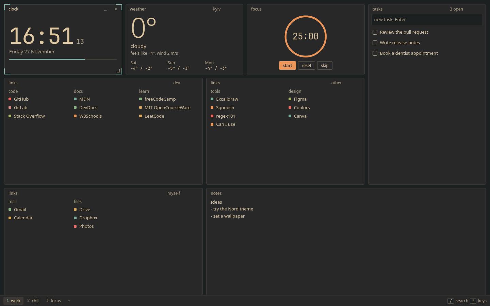
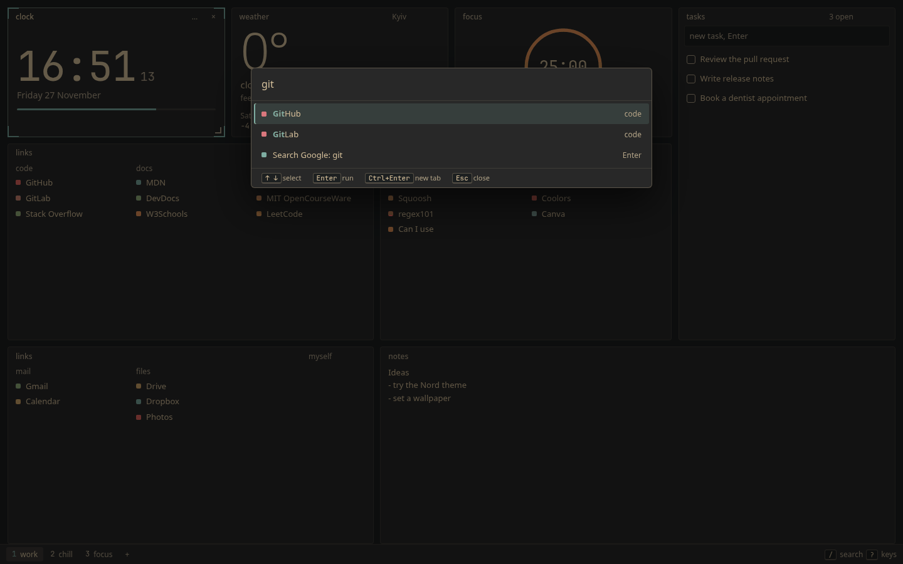
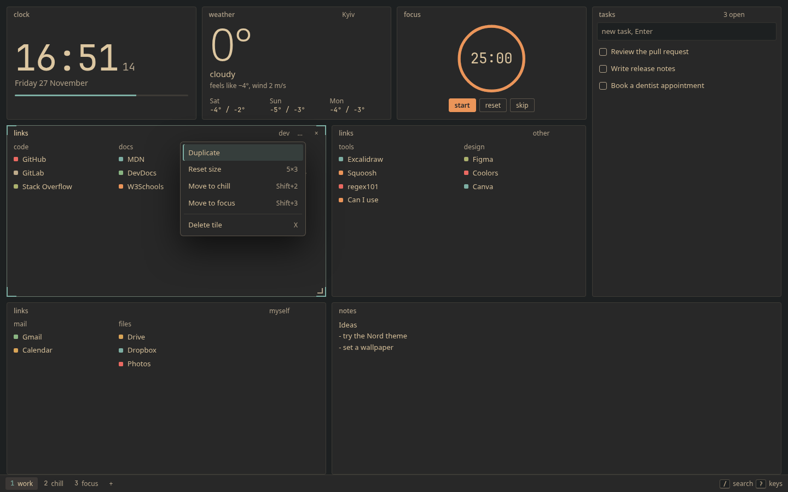
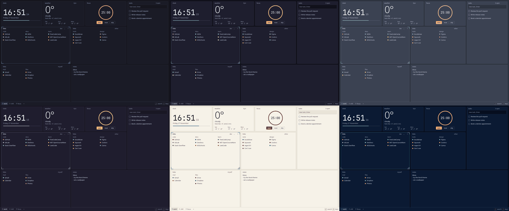
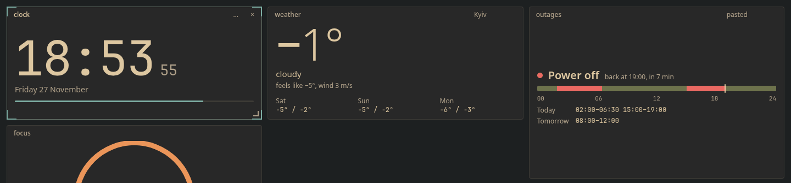
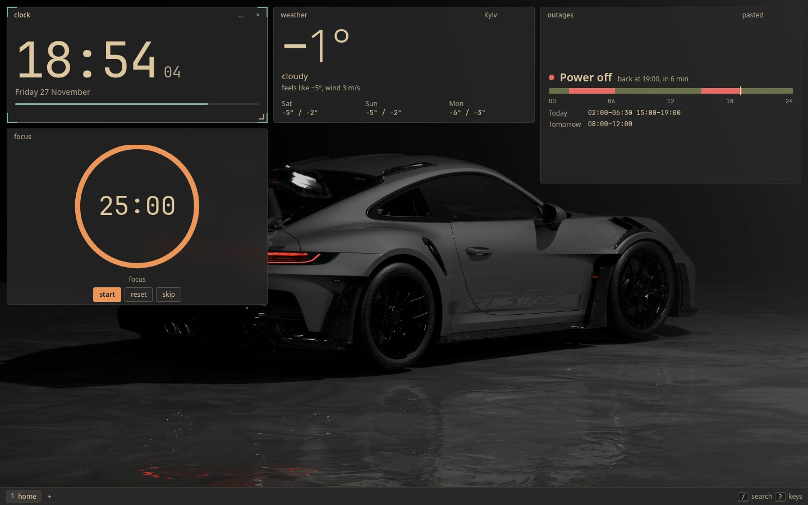
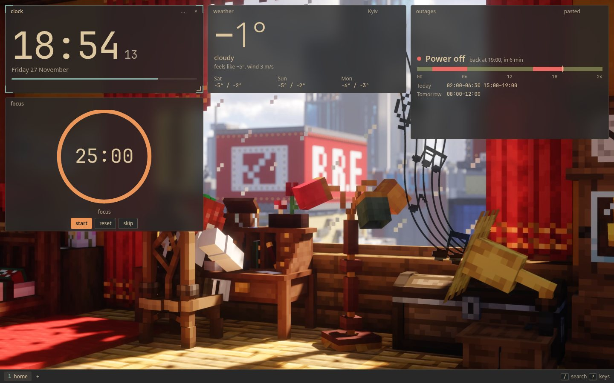

<div align="center">


# VEGA

**Visual Everyday Grid Assistant**

A keyboard-first tiling start page for Firefox and Chrome.<br>
Clock, weather, focus timer, tasks, notes, links, world clocks, countdowns, currency and crypto rates and ambient sounds on a grid you rearrange without touching the mouse.




</div>

## Why VEGA

A new tab is the page you see a hundred times a day. VEGA makes it calm, fast and useful: it renders instantly from local storage, everything is reachable from the keyboard, and nothing leaves your machine except an optional weather lookup.

- **Keyboard first.** Move between tiles with `h j k l`, go inside one with `Enter`, jump anywhere with the command bar (`/`). Every mouse action has a keyboard path, and keys work on any keyboard layout (they are matched by physical position).
- **Tiling grid.** A 12-column board. Tiles snap to the grid, push each other out of the way, and can be moved and resized from the keyboard.
- **Quiet by design.** A refined HUD look with one loud detail: the corner brackets on the focused tile.
- **Private.** No accounts, no analytics, no remote code. Data lives in your browser.
- **Zero build.** Plain HTML, CSS and JavaScript. Open `index.html` directly, or load it as an extension.

## Features

| | |
| --- | --- |
| **Widgets** | Clock (7 styles), weather, focus timer, tasks, notes, link groups, power outage schedule, world clocks, countdown, currency rates, ambient sounds, air-raid alerts. Each adapts its layout to the size you give it and has its own settings. See [docs/WIDGETS.md](docs/WIDGETS.md). |
| **Workspaces** | Up to nine boards (`1`–`9`), i3-style, each with its own layout. Send a tile to another workspace with `Shift`+`1`–`9`, the tile menu, the command bar, or by dragging it onto the workspace button. |
| **Command bar** | `/` or `Ctrl+K`. Fuzzy search over your links and commands. `! g query` searches a specific engine, `+ buy milk` adds a task. Typing in the wrong layout is detected. |
| **Tile menu** | Hover a tile, or press `M`: delete, duplicate, move to a workspace, reset size. |
| **Undo** | `Z` undoes deletes, duplicates, resets and moves, up to 20 steps. Notes come back with a restored tile. |
| **Themes** | Gruvbox Material (default), Tokyo Night, Catppuccin Mocha, Nord, Rosé Pine, Paper (light), Arc Reactor. Live preview, optional accent colour. All pass WCAG AA contrast. |
| **Wallpapers** | An image, GIF, WebP, or a looping video (MP4/WebM), from a URL or a file on your disk. Fit modes, and a check that tells you if the source is too small for your screen. |
| **Browser search** | Optional: search open tabs, bookmarks and history from the command bar (asks permission only when you enable it). |
| **Narrow windows** | Below ~700 px wide the tiles stack in one column. Your saved layout is never changed by a small window. |

<p align="center">
  
  
</p>

<p align="center">
  
</p>

## Install

**Firefox (from a release).** Download the signed `.xpi` from the [Releases](../../releases) page and open it, or install it from addons.mozilla.org once it is listed there.

**Firefox (try it from source).** Open `about:debugging#/runtime/this-firefox`, choose *Load Temporary Add-on*, and select `manifest.json`. Temporary add-ons are removed when Firefox restarts.

**Chrome, Edge, Brave.** Open `chrome://extensions`, enable *Developer mode*, choose *Load unpacked*, and select this folder. Chrome may warn about the `browser_specific_settings` key; it is only used by Firefox.

**Without an extension.** Open `index.html` in any browser. Everything works except tab/bookmark/history search and the new-tab features.

## Quick start

1. Open a new tab. The focused tile has corner brackets.
2. `h j k l` (or arrows) move between tiles. `Shift` + the same keys moves the tile. `r` resizes it.
3. `Enter` goes inside a tile: type in notes, walk through tasks and links with the arrows. `Esc` comes back.
4. `/` opens the command bar. `,` opens settings. `?` shows every shortcut.

## Keyboard shortcuts

Shortcuts are matched by physical key (`event.code`), so they work with any keyboard layout. Press `?` in VEGA for this list.

| Key | Action |
| --- | --- |
| `/` or `Ctrl+K` | Command bar |
| `h` `j` `k` `l` / arrows | Move focus between tiles |
| `Shift` + `h` `j` `k` `l` | Move the focused tile |
| `r` | Resize mode (`h` narrower, `l` wider, `k` shorter, `j` taller), `Esc` to exit |
| `Enter` | Go inside the focused tile |
| `Esc` | Leave a tile, close a dialog, leave a mode |
| `m` | Tile menu (configure, duplicate, move, reset size, delete) |
| `x` / `z` | Delete the focused tile / undo (up to 20 steps) |
| `Shift` + `1`–`9` | Send the focused tile to workspace N |
| `1`–`9` | Switch workspace |
| `a` | Add a module |
| `e` | Edit mode (grid, tile buttons, link tab picker) |
| `Space` | Start or pause the timer (timer tile focused) |
| `,` | Settings |
| `?` | Keyboard shortcuts |

Inside a tile: **notes** `Enter` puts the caret in the text; **tasks** `↓`/`↑` or `j`/`k` move, `Space` ticks, `x` removes, `i` types a new one; **links** arrows or `h j k l` move to the nearest link, `Enter` opens it, `Ctrl+Enter` opens a new tab.

## Power outage schedule (Ukraine)

> **This widget is specific to Ukraine.** Russia's attacks on Ukraine's energy infrastructure force the grid operators to switch power off by schedule, and people plan their day around those schedules. The *outages* widget exists for that. Outside Ukraine it has no use, and every other widget works without it.

The widget shows whether the power is on right now, a live countdown to the next change, and today's and tomorrow's schedule on a 24-hour bar (Kyiv time). The layout adapts to the tile size, and the last schedule is cached, so it still shows offline.



Three sources, chosen per tile:
- **[bezsvitla.com.ua](https://bezsvitla.com.ua/)** (default): automatic schedules for every region of Ukraine. You can find your queue by **street and house** (Kyiv and cities with street data) or pick or type it yourself (for example `3.1`).
- **[Yasno](https://yasno.ua/)**: automatic schedules for the operators Yasno publishes (Kyiv and Dnipro).
- **Paste a schedule**: works for any region. Paste the text from your Telegram bot or the operator's site. VEGA reads the time ranges, understands "today"/"tomorrow" and 🔴/🟢 lines, and rolls over at midnight.

Add several tiles and give each its own name (for example *Home* and *Work*) to follow more than one queue at once. Set up from the tile menu (`m` → *Configure…*) or press `Enter` on an unconfigured tile. The sites are asked for permission only when you configure the widget. VEGA does not work around sites that block automated access.

## Air-raid alerts (Ukraine)

> **This widget is specific to Ukraine too**, for the same reason as the outages widget: it exists to help people plan around Russia's attacks, not as general-purpose news.

Pin the oblast(s) you care about (click a circle on the map, or choose them in Settings) and the tile shows their live status from [alerts.in.ua](https://alerts.in.ua/), a rough estimate of how soon an alert might reach you based on how the alert area has been spreading, and a trip planner that compares that estimate against the places you might go. Notifications are optional. See [docs/WIDGETS.md](docs/WIDGETS.md#air-raid-alerts-ukraine-) for exactly what the estimate can and cannot tell you — it is a planning aid, never a safety source.

Optionally (off by default), it can also show live drone/missile tracks from [kudyletyt.com](https://www.kudyletyt.com/), an independent, volunteer-run monitoring project — not alerts.in.ua, not affiliated with VEGA, and with no formal API terms published, so treat it as best-effort. A track that is heading your way sharpens the estimate; turning it on asks its own permission.

## Wallpapers

Settings → Background accepts a URL, or **Choose file…** for an image or video on your disk. Local files are kept in the browser's IndexedDB (up to 300 MB) and are not included in JSON exports.

**Why does my wallpaper look soft?** VEGA never blurs a wallpaper: at 100 % scaling it is shown pixel for pixel. A picture looks soft when its source is smaller than your screen in *device* pixels. A 1920×1080 image on a 4K screen, or on a laptop with 150 % scaling, is stretched and cannot be sharp. Settings shows the source size next to your screen size and tells you when it will be enlarged.

- **Fit**: fill the screen (crops edges), fit inside (no cropping), or actual size (no scaling).
- **Sharpen enlarged images**: an optional edge-sharpening filter for still images. It improves edges modestly. It cannot add detail that is not in the file.
- **Video**: MP4, WebM or OGV by URL or file. It is muted, loops, pauses when the tab is hidden, and does not autoplay if your system asks for reduced motion. Codec support depends on your browser.
- Some sites block hotlinking. If a URL does not load, download the file and choose it from disk.

<p align="center">
  
  
</p>

<sub>The screenshots use third-party live wallpapers from wallsflow.com for illustration. They are not part of this repository; all trademarks and artwork belong to their respective owners.</sub>

## New tab focus (Firefox)

Firefox puts the cursor in the address bar on a new tab, so shortcuts do nothing until you click the page. Settings → New tab → **Focus the page, not the address bar** re-opens the tab once so the page gets focus. It can flicker briefly. An optional second switch hides the helper tab from "recently closed"; it asks for the `sessions` permission when you turn it on.

## Privacy and permissions

VEGA collects nothing. Data stays in your browser. The ambient sounds widget streams recordings from archive.org only while a sound is playing; the rates widget contacts the source you choose. Nothing is contacted otherwise.

| Permission | Required | Used for |
| --- | --- | --- |
| `https://api.open-meteo.com/*` | yes | The weather tile. Sends only the coordinates you set. |
| `https://geocoding-api.open-meteo.com/*` | optional | Finding a city by name in Settings. Asked the first time you search. |
| `https://bank.gov.ua/*` | optional | The rates widget (National Bank of Ukraine exchange rates). Asked when you set it up. |
| `https://api.monobank.ua/*` | optional | The rates widget, monobank buy/sell prices. Asked when you choose that source. |
| `https://data-api.binance.vision/*` | optional | The rates widget, crypto prices (Binance public market data). Asked when you choose that source. |
| `https://bezsvitla.com.ua/*` | optional | The outages widget, universal Ukrainian schedule & address lookup source. Asked when you configure it. |
| `https://app.yasno.ua/*` | optional | The outages widget, Yasno source. Asked when you choose it. |
| `https://api.alerts.in.ua/*` | optional | The air-raid alerts widget, official per-oblast status. Asked when you save a token. |
| `https://api.kudyletyt.com/*` | optional | The air-raid alerts widget, optional live drone/missile tracks (unofficial, see above). Asked only if you turn it on. |
| `tabs`, `bookmarks`, `history` | optional | Searching them from the command bar. Asked when you enable it. |
| `sessions` | optional | Hiding the helper tab of "Focus the page" from recently closed tabs. Asked when you enable it. |

Where data lives:

| Where | What |
| --- | --- |
| `localStorage` `hud.v1` | Layout, tasks, notes, links, settings |
| `localStorage` `hud.v1.backup` | A copy of your previous data, taken before an update, import or reset |
| `localStorage` `hud.weather` | Weather cache (15 minutes) |
| `localStorage` `hud.outage` | Outage schedule cache (the last few schedules) |
| IndexedDB `vega` | A local wallpaper file, if you chose one |

Wallpaper files are not part of exports. Move between browsers with **Settings → Export**, then **Import** in the other browser.

## Customising

Open settings with `,`: theme, accent colour, link groups (JSON for now), weather location, timer lengths, default search engine and wallpaper. The extension toolbar button opens a small menu with the same Settings entry, and the add-ons page has a *Preferences* button that does the same.

## Development

No build step: edit the files and reload. Tests are dev-only and need Node 18+:

```
npm install   # installs jsdom for the tests; nothing is bundled into the extension
npm test      # grid engine, data migration, moves and undo, keyboard modes, theme contrast, release hygiene
```

| File | Purpose |
| --- | --- |
| `manifest.json` | Extension manifest (Manifest V3, new tab override) |
| `index.html` | Page shell and script order |
| `theme-boot.js` | Applies the saved theme before first paint |
| `themes.css` | All theme colours, the only place with literal colours |
| `style.css` | Layout and components, derived from theme tokens |
| `strings.js` | All UI strings (English) |
| `grid.js` | Grid engine, pure functions |
| `state.js` | Defaults, `normalize()`, safe loading and backup |
| `bgstore.js` | IndexedDB storage for a local wallpaper |
| `outage.js` | Outage schedule logic (parsing, state, countdown), pure functions |
| `app.js` | Widgets, command bar, hotkeys, rendering |
| `popup.*`, `options.*` | Toolbar menu and the add-ons Preferences entry |
| `icons/` | Extension icons |
| `docs/` | [Widget reference](docs/WIDGETS.md) and README images |
| `tests/` | Smoke tests and a saved 0.1.0 data fixture (dev only) |

When you build a release zip, include the files the extension loads (everything above except `docs/`, `tests/`, `node_modules/` and `package*.json`) with `manifest.json` at the zip root.

Design rules: vanilla HTML/CSS/JS only, no inline scripts, hotkeys by `event.code`, all colours from theme tokens, data changes are additive and backward compatible. See [CONTRIBUTING.md](CONTRIBUTING.md).

## Roadmap

See the checklist in [docs/WIDGETS.md](docs/WIDGETS.md#checklist) and the [changelog](CHANGELOG.md).

- **0.4** Power outage schedule widget (shipped), more automatic sources as open data allows.
- **0.5** Clock styles and alignment, per-tile link settings, world clocks, countdown, currency rates, ambient sounds (shipped).
- **0.6** Air-raid alerts widget (shipped): the official alerts.in.ua status per oblast, a schematic map with your oblast(s) in focus, a spread-based arrival estimate, a trip planner, and optional live tracks from an independent project.
- **Next** a real boundary map for that widget (licensed oblast polygons) and live target positions, once a source permits reuse.
- **Ideas** a radio/music player, recorded sound loops.
- **Later** GitHub panel (pull requests, reviews, CI), calendar (ICS) and Google Calendar/Tasks, Jira panel and Jira-style tasks with a board view, RSS, bookmarks and history widgets, an in-page link editor, optional AI in the command bar (your own key, stored locally), browser sync, packaging scripts, English/Ukrainian UI switch.

## License

[MIT](LICENSE)
